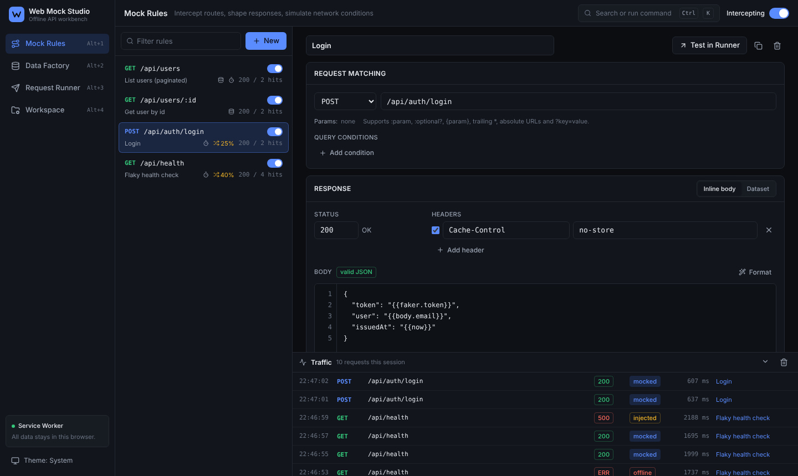
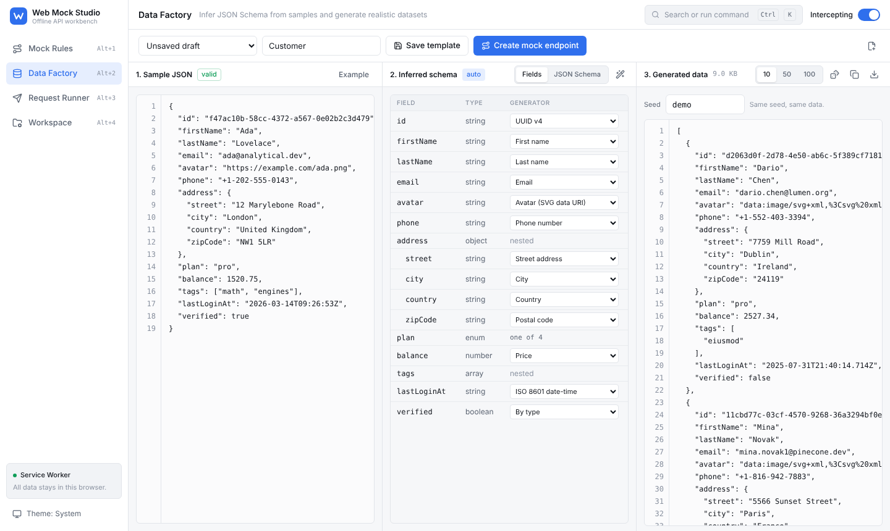
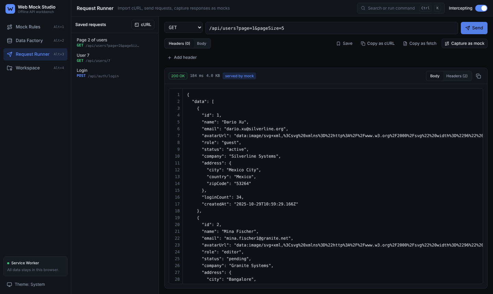
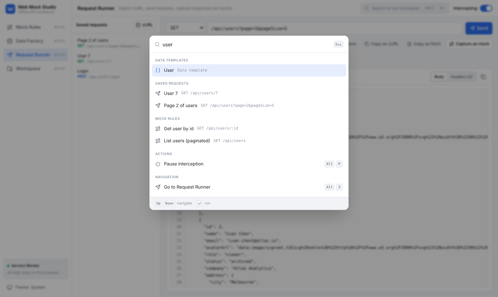
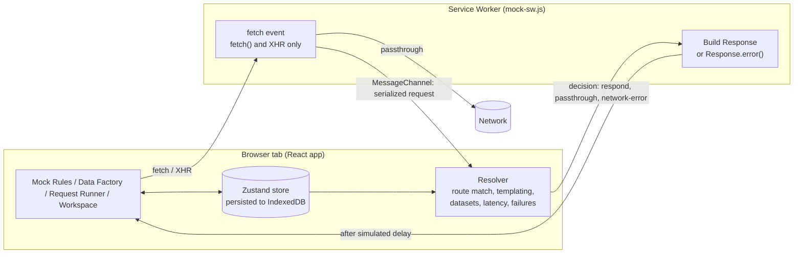

<div align="center">


# Web Mock Studio

**Mock any API in your browser. No server, no install, no account.**

A zero-backend, offline-first workbench for frontend engineers, QA and API developers:
intercept `fetch` and `XMLHttpRequest` with a Service Worker, reverse-engineer JSON Schema
from a sample payload, generate realistic data, and turn cURL commands into editable requests
and mock rules.

[](LICENSE)
[](https://github.com/zzoraemon043/web-mock-studio/actions/workflows/ci.yml)
[](.github/CONTRIBUTING.md)
[](tsconfig.app.json)
[](#architecture)

[Live demo](https://zzoraemon043.github.io/web-mock-studio/) |
[Quick start](#quick-start) |
[Features](#features) |
[Architecture](#architecture) |
[Recipes](#recipes) |
[Contributing](.github/CONTRIBUTING.md) |
[繁體中文](README.zh-TW.md)



</div>

---

## Why

Every frontend team eventually needs fake APIs: the backend is not ready, a staging server is
down, a bug only reproduces on a `503`, or a demo has to work on a plane. The usual answers
each carry friction: a Node mock server to install and keep running, a desktop app to
download, a SaaS account that stores your payloads on someone else's machine, or test-only
mocking libraries that never reach the browser you are clicking around in.

Web Mock Studio removes that friction. Open a tab, describe an endpoint, and every `fetch` or
XHR call made from that origin is answered by your rule, with the latency and failure modes
you choose. Everything is computed and stored in the browser, so it works offline and leaks
nothing.

## Screenshots

| Data Factory (light) | Request Runner (dark) |
| --- | --- |
|  |  |
| **Command palette (light)** | **Mock rules with failure injection (dark)** |
|  |  |

## Quick start

```bash
git clone https://github.com/zzoraemon043/web-mock-studio.git && cd web-mock-studio && npm install && npm run dev
```

Open `http://localhost:5173`. The starter workspace ships with four rules (paginated list,
lookup by id, templated login, flaky health check) so you can press **Send** in the Request
Runner and see mocked traffic immediately.

Requirements: Node.js 22.12 or newer for the dev server. The built app is static files and
runs on any HTTPS host or `localhost`.

```bash
npm test          # unit tests (router, cURL parser, schema inference, generators, resolver, import/export, codegen)
npm run build     # type-check and produce dist/
npm run preview   # serve the production build locally
```

## Features

| Area | Capability | Details |
| --- | --- | --- |
| **Interception** | Service Worker engine | Intercepts `fetch` and `XMLHttpRequest` from the page with no proxy or local server. Falls back to in-page `fetch` patching where Service Workers are unavailable. |
| | Route matching | `/users/:id`, optional `/:id?`, OpenAPI `/users/{id}`, trailing `*`, absolute URLs pinned to an origin, and query conditions (equals, present, absent, regex). The most specific rule wins regardless of list order. |
| | Response design | Status, headers, and a body with `{{params.id}}`, `{{query.page}}`, `{{headers.authorization}}`, `{{body.email}}`, `{{now}}`, `{{faker.uuid}}` and more. |
| | Network simulation | Presets for Fast 4G, 4G, 3G and Slow 3G, custom delay with jitter, and a failure rate that injects `400`, `401`, `403`, `404`, `429`, `500`, `502`, `503` or a real network failure. |
| | Traffic log | Every intercepted request with outcome (mocked, injected failure, offline, network), status, timing and the rule that served it. |
| **Data Factory** | Schema inference | Paste any JSON sample; a JSON Schema 2020-12 document is derived with `required`, nullable unions, numeric ranges, array bounds, formats and enum detection. |
| | Semantic fake data | 40 generators (names, emails, avatars, addresses, coordinates, UUIDs, timestamps, prices, text) chosen from field names and value shapes, without any third-party faker library. |
| | Coherent records | Fields in one record share a persona, so `firstName`, `lastName`, `email` and the avatar initials agree. |
| | Deterministic output | Seeded PRNG: the same seed always produces the same 10, 50 or 100 records. |
| | Dataset endpoints | Bind a template to a rule as an array, a paginated envelope that honors `?page=&pageSize=`, or a single item looked up by path parameter. |
| **Request Runner** | cURL import | Parses DevTools "Copy as cURL" (bash and cmd), Postman and documentation snippets: quoting, `$'...'`, line continuations, `-d`/`--data-*`, `--json`, `-F`, `-u`, `-b`, `-G`, `-I` and clustered flags. Paste straight into the URL bar. |
| | Send and capture | Send from the browser, inspect status, timing, size and headers, then capture the live response as a mock rule in one click. |
| | CORS guidance | Distinguishes likely CORS, mixed content and unreachable hosts, and offers offline alternatives. |
| | Export | Copy any request as cURL or `fetch()` code. |
| **Workspace** | Persistence | IndexedDB with localStorage fallback. |
| | Portable config | The entire workspace imports and exports as one validated JSON file, merged by id or replaced. |
| | Code generation | Export rules as Mock Service Worker v2 handlers, or as a dependency-free drop-in script that mocks `fetch` and XHR on any page. |
| **Experience** | Keyboard first | `Cmd/Ctrl+K` command palette, `Alt+1..4` tool switching, `Alt+N` new rule, `Alt+P` pause interception. |
| | Themes | Light, dark, or follow the system. |

## Architecture



Design decisions that matter:

- **The worker holds no rules.** It forwards each programmatic request to the page over a
  `MessageChannel`, and the page resolves it against live state. Rule edits apply instantly,
  there is a single implementation of matching logic, and the worker stays under 200 lines of
  plain JavaScript. Mock Service Worker uses the same split.
- **Only `fetch` and XHR are routed.** The worker skips navigations and any request with a
  non-empty `destination` (scripts, styles, images). That keeps the app able to boot itself
  and prevents a page from waiting on its own bootstrap modules.
- **Pure core, thin UI.** `src/core` (router, cURL parser, schema inference, generators,
  resolver, import validation, code generators) has no DOM or React dependency and is covered
  by unit tests that run in Node.
- **Determinism.** Generators run on a seeded `mulberry32` PRNG, and dataset rules are seeded
  from the template identity, so page 3 of a paginated endpoint is always cut from the same
  collection as page 1.
- **Imports are untrusted.** Every field of an imported workspace is type-checked, clamped and
  defaulted before it reaches persisted state.

```
src/
  core/        Framework-free logic with unit tests
    router/    Pattern compilation, matching, specificity scoring
    curl/      Shell tokenizer, cURL parser, cURL and fetch serializers
    schema/    JSON Schema inference, generation, field editing
    faker/     Corpus, generators, semantic key detection
    mock/      Resolver, templating, network simulation
    workspace/ Import, export, merge
    codegen/   MSW handlers and drop-in interceptor script
  runtime/     Service Worker bridge and in-page fallback
  store/       Zustand stores (workspace, UI, traffic)
  features/    Mock Rules, Data Factory, Request Runner, Workspace views
  components/  UI primitives, code editor, dialogs
public/
  mock-sw.js   The Service Worker
```

## Recipes

**Mock an endpoint your backend has not built yet.** `Alt+N`, set the pattern to
`/api/orders/:id`, write the body with `"id": "{{params.id}}"`, and call it from the Runner.

**Generate a realistic list from one example.** Paste a single object from your API spec into
the Data Factory, review the detected generators, then choose **Create mock endpoint** to get a
paginated `/api/<name>s` rule backed by 50 stable records.

**Reproduce a flaky production bug.** On the rule, choose the 3G profile, add 800 ms of
jitter, set failures to 30% with `503` and network failure selected, and watch how your loading
and retry states behave.

**Turn a DevTools request into a fixture.** In the browser's Network panel, use
"Copy as cURL", paste it into the Runner URL field, send it, then **Capture as mock**.

**Mock a third-party site you do not control.** Export the drop-in script from the Workspace
view and paste it into that site's DevTools console. Its `fetch` and XHR calls to the mocked
routes are answered locally.

**Share mocks with your team.** Export the workspace JSON and commit it, or export MSW
handlers for your test suite and Storybook.

## How it compares

| | Web Mock Studio | json-server | Mockoon | Mock Service Worker | Hosted mock services |
| --- | --- | --- | --- | --- | --- |
| Install required | None (open a tab) | Node package | Desktop app or CLI | npm package in your app | Account |
| Runs where | Browser tab | Local server | Local server | Your app or tests | Vendor cloud |
| Visual editor | Yes | No | Yes | No | Yes |
| Schema inference and fake data | Built in | No | Templating | No | Varies |
| Latency and failure injection | Per rule | Delay flag | Yes | In code | Varies |
| Data leaves your machine | Never | No | No | No | Yes |

Web Mock Studio is complementary to MSW: design and explore in the browser, then export
handlers for your automated tests.

## Deploying your own copy

The production build is static. Any HTTPS host works, since Service Workers require a secure
context (`localhost` is exempt).

GitHub Pages: in **Settings > Pages**, set the source to **GitHub Actions**, then add a
repository variable `PAGES_ENABLED` with the value `true`. The included
[`pages.yml`](.github/workflows/pages.yml) workflow builds and deploys on every push to `main`.
The build uses a relative base path, so it also works under a sub-path.

## Limitations

- Requests issued before the engine reports ready (the first few hundred milliseconds after
  load) go to the network.
- The in-page fallback, used when Service Workers are unavailable, patches `fetch` only.
- The Request Runner is subject to the browser's CORS rules for real network calls; mocked
  routes are not.
- Binary request bodies are read as text for matching and templating.

## Roadmap

- OpenAPI 3 import to scaffold rules and templates
- HAR import for bulk record and replay
- Stateful CRUD collections (POST appends, DELETE removes)
- Rule groups and per-environment profiles
- Browser extension to attach the engine to any tab

Ideas and pull requests are welcome; see [CONTRIBUTING](.github/CONTRIBUTING.md).

## License

Released under the [MIT License](LICENSE).

Copyright (c) 2026 zzoraemon043
